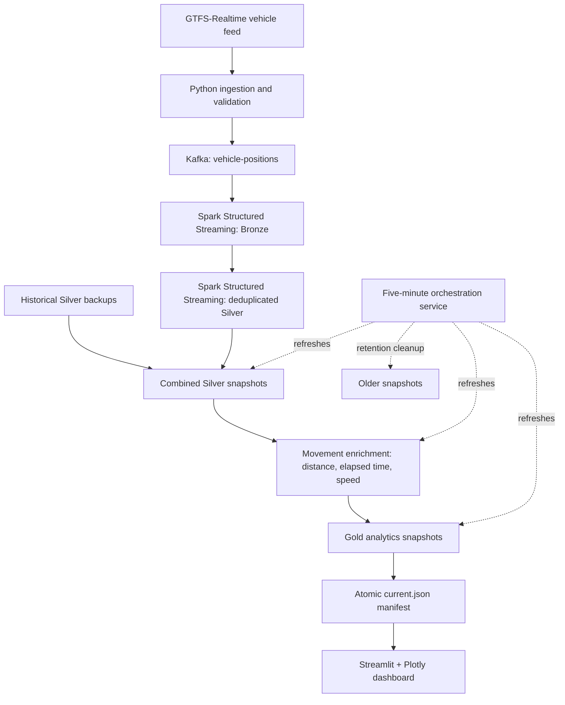

# Real-Time Mobility Analytics Platform

A local end-to-end mobility data engineering project that ingests GTFS-Realtime transit vehicle positions, streams events through Apache Kafka, processes observations with Apache Spark, and publishes analytics in a Streamlit dashboard.

## Architecture



## Features

- Python GTFS-Realtime ingestion and event validation.
- Kafka-based vehicle observation transport.
- Spark Structured Streaming Bronze and deduplicated Silver storage in Parquet.
- Historical/live Silver consolidation with observation-key deduplication.
- Movement enrichment with distance, elapsed time, calculated speed, and movement status (`FIRST_OBSERVATION`, `NORMAL`, `SUSPICIOUS_SPEED`).
- Gold fleet summary, route summary, and latest vehicle position datasets.
- Streamlit dashboard with fleet metrics, route analytics, and data freshness information.
- Five-minute analytics refresh service, versioned snapshots, manifest-based publication, retention cleanup, and single-instance file locking.

## Example verified local run

The following are observed results from a local run on **October 30, 2026**, not guaranteed values for future runs:

| Metric | Result |
|---|---:|
| Total observations | 125,076 |
| Distinct vehicles | 814 |
| Route groups | 98 |
| Normal movements | 124,065 |
| Suspicious-speed movements | 197 |
| First observations | 814 |

The full live ingestion-to-dashboard flow and one scheduled analytics refresh completed successfully. A second scheduled cycle has not yet been verified.

## Technologies

Python 3.13, Apache Kafka (Docker Compose), Apache Spark / PySpark 4.2.0, GTFS-Realtime, Parquet, Pandas, PyArrow, Plotly, and Streamlit.

## Repository structure

```text
.
├── dashboard/app.py
├── ingestion/fetch_live_data.py
├── orchestration/
│   ├── cleanup_snapshots.py
│   ├── refresh_combined_silver.py
│   └── refresh_pipeline.py
├── spark/
│   ├── bronze_stream.py
│   ├── silver_stream_dedup.py
│   ├── silver_movement_enrichment.py
│   ├── gold_analytics.py
│   └── check_*.py                 # diagnostic scripts
├── streaming/
│   ├── producer.py
│   └── consumer.py
├── validation/validate_vehicle.py
├── docker-compose.yml
├── requirements.txt
└── README.md
```

Generated datasets, checkpoints, backups, and virtual environments should be excluded from Git. Other experimental Spark scripts are retained in the source tree.

## Local setup (macOS)

### Prerequisites

- Docker Desktop
- Python 3.13
- Java 17 (the development environment used Homebrew OpenJDK 17)
- Network access to the GTFS-Realtime source configured in the ingestion code

From the repository root:

```bash
python3 -m venv .venv
source .venv/bin/activate
python -m pip install -r requirements.txt
export JAVA_HOME="/opt/homebrew/opt/openjdk@17"
export PATH="$JAVA_HOME/bin:$PATH"
export SPARK_LOCAL_IP=127.0.0.1
```

Adjust `JAVA_HOME` for your operating system and installation. In each new terminal, activate the virtual environment; use the Java/Spark exports in terminals that launch Spark.

### Start Kafka

```bash
docker compose up -d
docker exec realtime-kafka /opt/kafka/bin/kafka-topics.sh \
  --bootstrap-server localhost:9092 \
  --create --if-not-exists --topic vehicle-positions \
  --partitions 1 --replication-factor 1
```

**Important:** The development Kafka container currently uses an anonymous Docker volume for `/var/lib/kafka/data`. Avoid `docker compose down -v` or recreating the container without first planning data migration: Kafka offset loss can invalidate existing Spark checkpoints. Use `docker compose stop` to stop the existing container safely.

### Run the pipeline

Run each of the following in a **separate terminal**, from the project root, with `.venv` activated. Start Kafka first.

**Terminal 1 — Producer**

```bash
python -m streaming.producer
```

**Terminal 2 — Bronze Spark stream**

```bash
PYSPARK_SUBMIT_ARGS="--packages org.apache.spark:spark-sql-kafka-0-10_2.13:4.2.0 pyspark-shell" \
python spark/bronze_stream.py
```

**Terminal 3 — Silver Spark stream**

```bash
python spark/silver_stream_dedup.py
```

**Terminal 4 — Periodic analytics refresh**

```bash
python orchestration/refresh_pipeline.py
```

**Terminal 5 — Dashboard**

```bash
python -m streamlit run dashboard/app.py
```

Open the local URL printed by Streamlit (typically `http://localhost:8501`). The dashboard reads the latest published Gold snapshot.

To stop, use `Ctrl+C` in each terminal, then `docker compose stop` for Kafka.

## Analytics and retention details

- The combined Silver refresh merges historical Silver datasets with committed live Silver observations, then deduplicates using vehicle ID, vehicle timestamp, latitude, and longitude.
- Movement enrichment computes per-vehicle movement features and flags suspicious speeds.
- Gold publication writes a versioned snapshot and updates `data/gold_snapshots/current.json` after verification.
- The refresh service schedules a new analytics cycle approximately every 300 seconds, counting processing time toward the interval.
- The cleanup utility normally retains the five most recent snapshots per layer and protects the currently published Gold snapshot.
- A local Streamlit-process check skips Gold deletion when the dashboard is detected. This is a development safeguard, **not** distributed reader coordination.
- The refresh service has a single-instance process lock, tested by verifying that a second process could not acquire it.

## Reproducibility notes and limitations

- **Historical input configuration:** The current combined Silver script references dated local backup directories. A fresh clone will not contain these backups, so configure available historical sources or adapt the script for live-only operation before expecting a full end-to-end run.
- **Feed configuration:** The GTFS endpoint and any credentials or access requirements depend on the ingestion implementation. Inspect and configure it for your environment; never commit secrets.
- **Kafka durability:** Explicit named-volume persistence and safe migration of existing Kafka data remain future work.
- **Operational validation:** One scheduled refresh cycle and local lock/dashboard cleanup safeguards were verified. Long-running unattended operation, concurrent readers, and recovery after broker recreation have not been fully validated.
- **Environment:** This project was developed and tested locally on macOS, not deployed to a production cloud environment.

## Future improvements

- Configurable historical/live data source paths and fresh-clone bootstrap.
- Explicit durable Kafka storage and recovery procedures.
- Automated tests and continuous integration.
- Stronger snapshot reader coordination and retention policies.
- Containerization, monitoring, and cloud deployment.

## Purpose

This project demonstrates streaming data engineering, data quality validation, Spark transformation pipelines, medallion-style analytics, orchestration, and interactive visualization using a public transit mobility use case.
