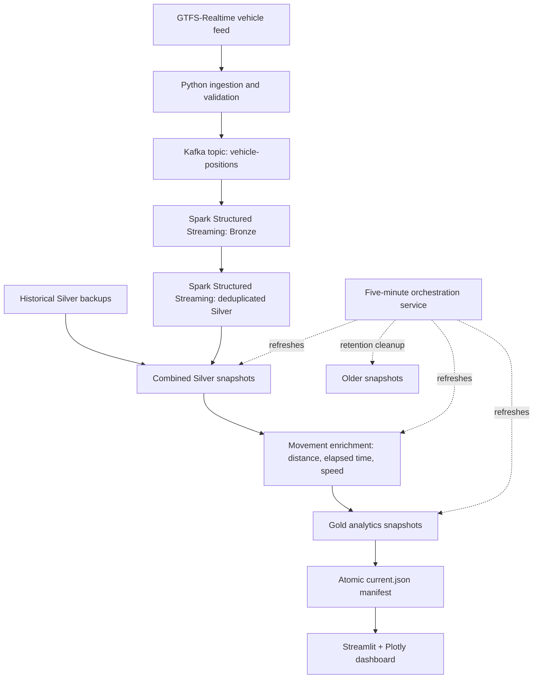

# Real-Time Mobility Analytics Platform

**End-to-end transit data engineering with GTFS-Realtime, Apache Kafka, PySpark, and Streamlit.**

A locally developed streaming analytics platform that ingests public-transit vehicle positions, validates and transports events through Kafka, processes observations through Bronze and Silver layers, enriches vehicle movements, and publishes Gold analytics to an interactive dashboard.

The project emphasizes **data quality, deduplication, reproducible analytics, and safe snapshot publication**. It is a local engineering demonstration, not a production cloud deployment.

## Verified local results

The following metrics were observed during a successful local run on **October 30, 2026**. They describe that run only, not ongoing throughput or model performance.

| Metric | Observed result |
| --- | ---: |
| Vehicle observations processed | **125,076** |
| Distinct vehicles | **814** |
| Route groups | **98** |
| Normal movements | **124,065** |
| Suspicious-speed movements | **197** |
| First observations | **814** |

The live ingestion-to-dashboard path completed successfully. One scheduled analytics refresh was verified; a second scheduled cycle and prolonged unattended operation have not yet been validated.

## System architecture



### Pipeline stages

1. **Ingestion and validation:** Read vehicle positions from a GTFS-Realtime feed and validate incoming records before publishing.
2. **Event transport:** Publish valid vehicle observations to the Kafka `vehicle-positions` topic.
3. **Bronze streaming:** Consume Kafka events with Spark Structured Streaming and persist the raw observation layer in Parquet.
4. **Silver processing:** Deduplicate streaming observations, then combine live Silver data with configured historical Silver backups.
5. **Movement enrichment:** Compute per-vehicle distance, elapsed time, and derived speed; classify observations as `FIRST_OBSERVATION`, `NORMAL`, or `SUSPICIOUS_SPEED`.
6. **Gold analytics:** Produce fleet summaries, route summaries, and latest vehicle positions.
7. **Dashboard publication:** Write versioned Gold snapshots, update the `current.json` manifest, and visualize the published results with Streamlit and Plotly.

**Note:** `SUSPICIOUS_SPEED` is a movement-rule classification, **not a trained machine-learning model** or a verified fraud/anomaly ground-truth label.

## Engineering highlights

- **Streaming pipeline:** Kafka decouples live feed ingestion from Spark processing.
- **Data quality:** Input validation and Silver-layer deduplication reduce invalid and repeated observations.
- **Historical + live consolidation:** Combined Silver snapshots deduplicate using vehicle ID, vehicle timestamp, latitude, and longitude.
- **Movement analytics:** Enriched records support fleet monitoring and investigation of implausible movement speeds.
- **Snapshot-based serving:** Gold datasets are versioned; a `current.json` manifest identifies the published snapshot for dashboard readers.
- **Orchestration:** A local refresh process targets approximately five-minute analytics cycles and uses a file lock to prevent a second local instance from running simultaneously.
- **Retention safeguards:** Cleanup retains recent snapshots and protects the currently published Gold snapshot; a local Streamlit-process check skips Gold deletion while the dashboard is detected.

These safeguards are **local development mechanisms**, not guarantees of distributed coordination or production fault tolerance.

## Technology stack

| Layer | Technologies |
| --- | --- |
| Ingestion and validation | Python 3.13, GTFS-Realtime, Requests, Protobuf |
| Messaging | Apache Kafka, Docker Compose |
| Stream processing | Apache Spark / PySpark 4.2.0, Spark Structured Streaming |
| Storage and analytics | Parquet, Pandas, PyArrow |
| Dashboard | Streamlit, Plotly |
| Orchestration | Python scripts, local file locking, snapshot manifests |

## Repository structure

```text
.
├── dashboard/
│   └── app.py
├── ingestion/
│   └── fetch_live_data.py
├── orchestration/
│   ├── cleanup_snapshots.py
│   ├── refresh_combined_silver.py
│   └── refresh_pipeline.py
├── spark/
│   ├── bronze_stream.py
│   ├── silver_stream_dedup.py
│   ├── silver_movement_enrichment.py
│   ├── gold_analytics.py
│   └── check_*.py              # diagnostics and data-quality checks
├── streaming/
│   ├── producer.py
│   └── consumer.py
├── validation/
│   └── validate_vehicle.py
├── docker-compose.yml
├── requirements.txt
└── README.md
```

Other experimental Spark scripts are retained in the repository. Generated datasets, backups, checkpoints, virtual environments, and local credentials are excluded from version control.

## Local development setup

> **Reproducibility limitation:** The current combined Silver refresh references dated historical backup directories that are not included in this repository. A fresh clone needs suitable historical data paths or an adaptation for live-only processing before the entire analytics flow can be reproduced. The instructions below document the development workflow; they are not a guaranteed one-command fresh-clone deployment.

### Prerequisites

- macOS (the environment used for local development)
- Python 3.13
- Docker Desktop with Docker Compose
- Java 17 (the development environment used Homebrew OpenJDK 17)
- Network access and valid authorization for the configured GTFS-Realtime feed

### 1. Create a Python environment

From the repository root:

```bash
python3 -m venv .venv
source .venv/bin/activate
python -m pip install -r requirements.txt
```

For the development machine's Java/Spark configuration:

```bash
export JAVA_HOME="/opt/homebrew/opt/openjdk@17"
export PATH="$JAVA_HOME/bin:$PATH"
export SPARK_LOCAL_IP=127.0.0.1
```

Adjust `JAVA_HOME` for your own Java installation. Activate `.venv` in each new terminal and set the Java/Spark environment variables in terminals that launch Spark.

### 2. Configure GTFS-Realtime access

Create a file named `.env` in the repository root containing:

```dotenv
VALLEY_METRO_API_KEY=YOUR_VALID_API_KEY
```

Replace the placeholder with a valid credential from the feed provider. The ingestion module reads this value through `python-dotenv`.

**Never commit `.env`, API keys, tokens, or credentials.** The `.gitignore` excludes `.env`. Live ingestion will not work without valid feed access, but repository documentation and previously generated local datasets do not require an active key.

### 3. Start Kafka

```bash
docker compose up -d
docker exec realtime-kafka /opt/kafka/bin/kafka-topics.sh \
  --bootstrap-server localhost:9092 \
  --create --if-not-exists --topic vehicle-positions \
  --partitions 1 --replication-factor 1
```

**Data persistence warning:** The development Kafka container currently uses an **anonymous Docker volume** at `/var/lib/kafka/data`. Do not use `docker compose down -v` or recreate the container without planning Kafka data migration. Losing Kafka offsets can invalidate existing Spark checkpoints. To stop the existing container safely, use `docker compose stop`.

### 4. Run the pipeline

Start each process in a **separate terminal**, from the repository root, with the virtual environment activated. Start Kafka first.

**Terminal 1 — Producer**

```bash
python -m streaming.producer
```

**Terminal 2 — Bronze Spark stream**

```bash
PYSPARK_SUBMIT_ARGS="--packages org.apache.spark:spark-sql-kafka-0-10_2.13:4.2.0 pyspark-shell" \
python spark/bronze_stream.py
```

**Terminal 3 — Deduplicated Silver stream**

```bash
python spark/silver_stream_dedup.py
```

**Terminal 4 — Analytics refresh**

```bash
python orchestration/refresh_pipeline.py
```

**Terminal 5 — Dashboard**

```bash
python -m streamlit run dashboard/app.py
```

Open the URL printed by Streamlit (typically `http://localhost:8501`). The dashboard reads the latest **published** Gold snapshot.

Stop each foreground process with `Ctrl+C`, then stop Kafka with:

```bash
docker compose stop
```

## Analytics and snapshot lifecycle

- **Combined Silver:** Merge configured historical Silver sources with committed live Silver observations, then deduplicate using vehicle ID, timestamp, latitude, and longitude.
- **Movement enrichment:** Calculate per-vehicle movement features and flag suspicious speeds using the project's movement rules.
- **Gold publication:** Write a versioned snapshot and update `data/gold_snapshots/current.json` after verification.
- **Refresh cadence:** The orchestration service targets a cycle roughly every 300 seconds, including processing time.
- **Retention:** Cleanup normally retains the five most recent snapshots per layer and protects the current published Gold snapshot.
- **Reader safeguard:** Gold deletion is skipped when a local Streamlit process is detected. This is a development safeguard, **not** distributed reader coordination.
- **Single-instance execution:** A local file lock was tested by confirming that a second refresh process could not acquire it.

## Validation status and known limitations

| Area | Status |
| --- | --- |
| Live feed → Kafka → Spark → dashboard | Verified in a local run |
| Example analytics results | Verified on October 30, 2026 |
| One scheduled refresh cycle | Verified |
| Duplicate local refresh prevention | Verified with a second-process lock test |
| Dashboard-aware cleanup safeguard | Checked locally |
| Second scheduled cycle and long-running reliability | Not yet verified |
| Fresh-clone end-to-end bootstrap | Not yet supported without historical input configuration |
| Broker recreation / offset recovery | Not fully validated |
| Cloud deployment and distributed coordination | Not implemented |
| Automated test suite and CI | Future work |

## Next engineering improvements

1. Make historical data paths configurable and support a clean live-only bootstrap.
2. Add automated tests for validation, deduplication, and movement enrichment, plus CI.
3. Document Kafka persistence and recovery; migrate to explicitly managed durable storage where appropriate.
4. Strengthen dashboard-reader coordination and snapshot retention for concurrent access.
5. Add real dashboard screenshots and an operational walkthrough.
6. Evaluate monitoring and deployment options after local reproducibility is improved.

## Project scope

This repository demonstrates practical **streaming data engineering**, **medallion-style data processing**, **data quality controls**, **movement analytics**, **orchestration**, and **interactive visualization** in a public-transit use case. It is intended as a transparent, locally validated engineering project with clearly documented next steps.
